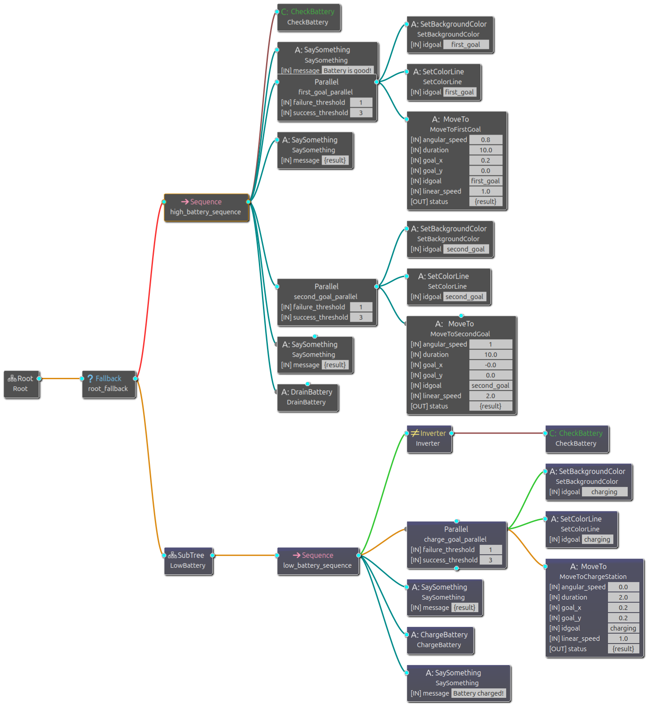
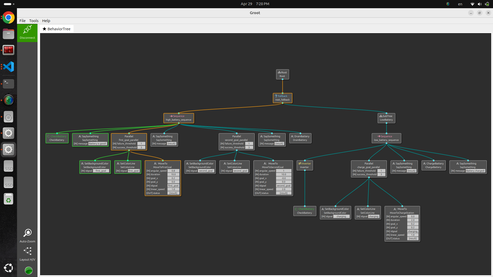
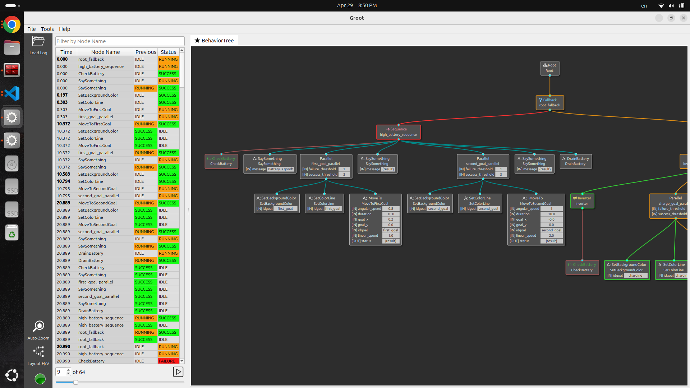

# ROS2 Behavior Tree for Turtlesim

This repository demonstrates a Behavior Tree (BT) in ROS 2 using a simulated turtle (`turtlesim`). The tree controls the turtle based on its battery level: the turtle visits two goals when the battery is charged, or moves to a charging station and recharges when the battery is low.

## Table of Contents
- [Demo](#-demo)
- [Overview](#overview)
- [Behavior Tree Architecture](#behavior-tree-architecture)
- [Setup](#setup)
- [Launch Instructions](#launch-instructions)
- [Behavior Trees and Groot](#behavior-trees-and-groot)
- [Monitoring and Logging](#monitoring-and-logging)

# 🎥 Demo


# Overview

This example integrates a Behavior Tree with a ROS 2 node (`turtle_bt`) to simulate decision-making behavior based on battery status. The turtle executes tasks by:

- **Checking battery level** and branching behavior accordingly.

- **Navigating to specified goals** with configurable target coordinates and linear/angular speeds.

- **Providing visual cues** via dynamic **pen** and **background color changes** to indicate operational state.

- **Displaying status messages** to the console for easier debugging and state tracking.

This behavior is orchestrated using a Behavior Tree (defined in `config/turtle_tree.xml`), which is modular, readable, and easy to extend. The tree uses BehaviorTree.CPP v4 XML format and a `Fallback` to select the high-battery or low-battery path.


# Behavior Tree Architecture


The Behavior Tree is defined in XML and consists of two major paths:

### 1. High Battery Path
Executed when the battery level is **at least 50%**:
- Say: "Battery is good!"
- Navigate to the **first goal**
  - Set the pen color to **green**
  - Set the background to **pink-purple**
- Say arrival message
- Navigate to the **second goal**
  - Set the pen color to **purple**
  - Set the background to **light blue**
- Say arrival message
- Drain the battery by 20 percentage points

### 2. Low Battery Path
Executed when the battery is **below 50%**:
- Move to the charging station
  - Set the pen color to **gold**
  - Set the background to **dark slate gray**
- Report arrival at the charging station
- Increase the battery level by 30 percentage points, capped at 100%
- Say: "Battery charged!"

Each group of visual and navigation actions runs in a `Parallel` node with `success_count="3"` and `failure_count="1"`. The low-battery behavior is defined as the `LowBattery` subtree and is selected by the root fallback when the high-battery sequence fails.


---

# Setup

1. **Install ROS 2**: This package is configured for ROS 2 Jazzy. Install ROS 2 and source its environment before building.

2. **Install Dependencies**:
   - `rclcpp`: ROS 2 C++ client library.
   - `geometry_msgs`: Provides message types for motion commands.
   - `turtlesim`: Simulates a turtle in a 2D space.
   - `ament_index_cpp`: Locates the installed package configuration.
   - [`behaviortree_cpp`](https://github.com/BehaviorTree/BehaviorTree.CPP): BehaviorTree.CPP v4 runtime.
   - [`btick`](https://github.com/BehaviorTree/btick): Behavior Tree monitoring and recording.
   - `nav2_msgs` and `std_msgs`: ROS 2 message dependencies used by the package.
   - [`Groot`](https://github.com/BehaviorTree/Groot): Visual editor and debugger for Behavior Trees.

3. **Clone the Repository**:
   Clone this repository into the `src` directory of a ROS 2 workspace and build the package.
   ```bash
   cd ~/your_ros2_ws/src
   git clone https://github.com/sheriffathey/Turtlesim_BT.git
   cd ..
   colcon build
   ```

4. **Source the Setup**:
   After building the package, source the workspace.
   ```bash
   source install/setup.bash
   ```

# Launch Instructions

Run the demo with the following command:
```bash
ros2 launch turtlesim_bt launch_turtlesim_bt.launch.py
```

You should see the turtle moving, changing pen and background colors, and reacting to battery state changes dynamically. The executable loads `config/turtle_tree.xml` from the installed package share directory.


## Behavior Trees and Groot


#### What Are Behavior Trees?

**Behavior Trees** are a modern alternative to Finite State Machines (FSMs) used for decision-making in robotics and AI systems. They:

- Are modular and easier to debug

- Allow for fallback and sequential logic

- Separate **conditions** from **actions**

Behavior Trees are composed of control nodes (such as **Sequence**, **Fallback**) and leaf nodes (Conditions and Actions). In this project:

- CheckBattery is a condition node

- MoveTo, SetColorLine, SetBackgroundColor, SaySomething, ChargeBattery, and DrainBattery are action nodes

- A **Sequence** node (→) executes its children from left to right and fails if any child fails.

- A **Fallback** node (?) attempts children in order and succeeds when the first child succeeds.

- A **Parallel** node executes the visual and navigation actions together. In this project, all three children must succeed (`success_count="3"`), and one child failure fails the group (`failure_count="1"`).

These provide clean and modular logic to build decision-making flows.

### Using Groot

#### What is Groot?
**Groot2** is a graphical interface developed by the BehaviorTree.CPP authors to:

- Design Behavior Trees visually using XML

- Monitor BT execution in **real time**

- Replay logs from past BT runs for debugging and analysis

### 📡 Real-Time Monitoring in Groot

To visualize and debug the Behavior Tree in real time, Groot2 communicates with the application through the `Groot2Publisher` configured by the runner.

#### 🛠️ How to Connect Groot
The runner creates the Groot2 publisher on port `1669`:

```cpp
BT::Groot2Publisher publisher(tree, 1669);
```

1. Run your ROS 2 BT application.

2. Open Groot2 and connect to the running publisher.

3. Use **`localhost:1669`** for a local run, or the host machine's address and port when connecting remotely.

You will see live updates with color-coded statuses:

- 🟩 Green: Success

- 🟨 Yellow: Running

- 🟥 Red: Failure



### 📼 Log Replay in Groot

Groot includes a powerful **Log Replay** feature, which lets you visualize and analyze Behavior Tree executions **after they happen**, using saved logs.

#####  ✅ What You Can Do with Log Replay:
- Step through a previously executed Behavior Tree f**rame by frame**

- See the status of each node (Success, Failure, Running) **at each time step**

- Debug complex behaviors without rerunning the entire ROS 2 simulation

- Share logs with teammates for collaborative debugging or performance reviews

### 🛠 How to Use Log Replay
1. Generate a Log File
    The runner records execution through `btick`:

    ```cpp
    btick::Monitor monitor(node, tree, "TurtleTree", tree_file_path);
    btick::Logs logs(monitor, "my_recording.json", true);
    ```

    >💡 This generates a JSON recording. Configure the output path to a writable location on your machine.

2. Open Groot2 and select its log/replay view.

3. Load Your Log File

    - Select the JSON file produced by `btick`.

    - Groot will load your behavior tree and the recorded execution timeline.

4. Replay and Analyze

    - Use the timeline controls (play, pause, step) to inspect the execution.

    - Watch each node change color over time (🟢 Success, 🔴 Failure, 🟡 Running).

    - Identify where things went wrong or verify that behaviors triggered as expected.



This integration makes it easy to iterate on logic design and monitor the runtime status of each node, including color-coded feedback and status updates.

## Monitoring and Logging

The node uses:

- `btick::Monitor` to observe the `TurtleTree` execution.
- `btick::Logs` to record execution data as JSON.
- `BT::Groot2Publisher` on port `1669` for live Groot2 visualization.

The sample source currently contains a machine-specific recording path. Change that path in `src/turtle_bt.cpp` to a writable location before enabling persistent recordings on another machine.
